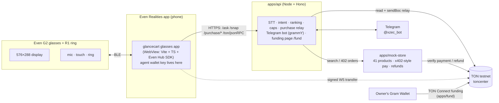

# GlanceCart

**Say it, see it, hold to buy.** Voice shopping for Even Realities G2. Tell your glasses what you need, glance at three options, and hold the touchpad or R1 ring to pay from a spending-capped agent wallet on TON, funded from your Gram Wallet.

- **Hackathon:** Heads Up: Even Realities Hackathon (TVM Ventures × Daos Hub), Nov 23–29, 2026
- **Main track:** 02 · Crypto & DeFi (Gram Wallet). **Second track:** 01 · Messaging (Telegram bot). Also entering **Best Telegram integration**.
- **Network:** TON **testnet** only, paid in test GRAM. No mainnet keys anywhere.

## 30-second pitch

You're out of coffee beans and your hands are full. Saying "reorder the coffee beans" shows the same bag on your glasses, with its price and your remaining budget. Hold the ring to buy it. You have 30 seconds to tap and cancel, then the receipt lands in Telegram.

The agent pays from a small wallet that only holds what you put in. The key never leaves your phone, it can't spend past your caps, and you can revoke it from Telegram in one tap. G2 is the display, voice and confirm button. Custody stays with you, and the money moves on TON.

## What it does

| Moment | On the glasses | Behind it |
|---|---|---|
| **Say it** | Tap, then "USB-C cable under 15 dollars by Friday" | Glasses mic → PCM → API → speech-to-text (Deepgram, swappable) |
| **Think** | "Searching the store..." | Claude (`claude-sonnet-5-5`) → `{query, maxUsd, deadline, preferences}`, with a rule-based fallback |
| **See it** | `2/3  USB-C cable 2m braided` · `$12.40 · 0.124 GRAM · arrives Thu` · `Why: top rated, 4.6★` | Store search + ranking (cheapest / top rated / fastest) |
| **Confirm** | Total, wallet after purchase, cap left today. **HOLD to buy**; a single tap never buys | Caps + balance checked before the hold is accepted |
| **Pay** | "Confirming on TON testnet..." | HTTP 402 quote → phone signs a W5 transfer → store sees it on-chain |
| **Done** | `Paid` · `Tap = cancel (29s)` | Refund from the store if cancelled; Telegram receipt after the window |

Extras:
- **Reorder** ("same as last time"): finds your last matching purchase and shows it as one card.
- **Snap-to-buy**: photo from the phone camera → product + shelf price → "$12.00 less than here ($34.00)".
- **@xzec_bot**: receipts, daily summary, `/caps` buttons, `/topup`, `/revoke`.

## Architecture



**Payment flow (x402-style):**
1. **Quote.** The API checks caps, then the store answers `402 Payment Required` with `{network: tvm:-3, asset: GRAM, amount, payTo, memo: orderId, expiresAt}`.
2. **Sign.** The phone checks the quote (testnet, amount no higher than the price shown, not expired), the caps and the balance, then signs the transfer locally.
3. **Relay.** The API sends the signed transfer as `X-Payment`, and the store broadcasts it.
4. **Confirm.** The store watches its wallet for the memo, then marks the order `paid` with `cancelUntil = +30 s`.

| Package | What |
|---|---|
| `apps/glasses` | G2 app: screens, gestures, mic capture, phone-side agent wallet, phone panel |
| `apps/api` | STT, intent (Claude + rules), ranking, reorder, snap-to-buy, caps, purchase relay, TON relay, Telegram bot, receipts |
| `apps/mock-store` | Catalog, 402 order flow, on-chain payment check, refunds from the store's own testnet wallet |
| `apps/fund` | Static TON Connect page to fund the agent wallet from Gram Wallet (GitHub Pages or `/fund/`) |
| `packages/shared` | Types, caps logic, x402 types, TON wallet helpers |

## How it meets the judging criteria

| Criterion | How GlanceCart meets it |
|---|---|
| **Usefulness on G2 (30%)** | An everyday moment: you notice you need something while your hands are busy. One idea per screen, three options at most, nothing to read on the phone. Reorder covers the most common case in one sentence and one hold. |
| **Read and write (25%)** | Reads: product options, wallet balance, cap left, order status. Writes: a **real TON testnet payment**, a cancel/refund, cap changes and revoke (from the phone or Telegram). Each action takes a short phrase plus a hold, with smart defaults (cheapest, top rated, fastest) and an AI "why" line. |
| **Technical execution (20%)** | Works end to end in the simulator. 105 tests cover catalog search, intent parsing, ranking, caps, the 402 order flow, purchase routes, the Telegram bot, receipts, reorder, snap mapping, WAV encoding, and every screen and error line against the display budget. Every LLM step falls back to rules, so the demo never hard-fails on the model. |
| **UX for display and voice (15%)** | Every screen is ≤ 8 lines × 46 chars, enforced by tests. It uses only glyphs the G2 font has (`·` `★`; no `✓` or `…`). Gestures are consistent: tap = next, swipe = browse, hold = buy, double tap = back or exit. Every failure is one readable line. |
| **Business potential and safety (10%)** | Agentic commerce with hard limits: the key stays on the phone, caps are enforced in three places, the balance is the hard cap, purchases are confirmed with a deliberate hold, there is a 30 s cancel window with refunds, revoke sweeps funds back to the owner's Gram Wallet, and it is testnet only. The store side is x402-style, so any 402-speaking merchant could plug in. |

## Trust and safety

- **Non-custodial.** The agent wallet key is generated on the phone and stored in the Even app's storage. The server only ever sees the address and already-signed transfers. Rules: "Do not hold user funds".
- **Caps** (default 0.5 GRAM per purchase, 1 GRAM per 24 h) are enforced in three places:
  1. The phone refuses to sign over them, counting its own local spend ledger.
  2. The API refuses to quote or relay over them.
  3. The wallet balance is the hard ceiling.
- **Deliberate confirm.** Only a hold on the confirm screen buys, and only when no cap or balance rule blocks it. The confirm screen always shows the wallet balance and the cap left after purchase.
- **Cancel window.** For 30 s after payment, a tap gets a refund from the store's own testnet wallet. The Telegram receipt is only sent after the window closes.
- **Revoke.** From the phone it blocks purchases and sweeps the whole balance back to the wallet that funded it; that address is read from the chain, not the server. From Telegram it blocks purchases immediately.
- **Mic.** It is only on between your tap and your stop tap, for at most 12 s. Nothing records in the background.
- **Secrets.** All keys live in `.env` (gitignored) on the server. There are no API keys in the app. Testnet only.

Known gaps:
- The agent key is not encrypted at rest. Doing that properly needs the platform keystore.
- The API tracks each wallet's spend in a JSON file.

PLAN.md lists all decisions (D1–D28).

## Run it (simulator, free)

```bash
pnpm install
cp .env.example .env      # every key is optional; see below
pnpm dev                  # mock store :8788, API :8787, glasses app :5173
pnpm sim                  # Even Hub simulator → localhost:5173
pnpm test                 # 105 tests
```

**On the glasses:**
- **Tap** to talk, and tap again when done.
- **Swipe** to browse the cards, **tap** to select one.
- **Hold** to buy, then **tap** within 30 s to cancel.
- **Swipe** on the home screen to snap a photo.
- **Double tap** goes back, or exits on the home screen.

**Without keys:**
- No `ANTHROPIC_API_KEY`: intent parsing and ranking use rules. Snap-to-buy says "Photo search not set up".
- No `DEEPGRAM_API_KEY`: speaking shows "Speech service not set up". Type a request in the phone panel instead, or script one for the simulator: `npx evenhub-simulator "http://localhost:5173/?say=AA%20batteries%20by%20tomorrow"` (dev builds only).

| Key | Where to get it | Cost |
|---|---|---|
| `DEEPGRAM_API_KEY` | console.deepgram.com | free signup credit |
| `ANTHROPIC_API_KEY` | console.anthropic.com | paid (optional) |
| `TELEGRAM_BOT_TOKEN` | @BotFather | free |
| `TONCENTER_API_KEY` (testnet) | @tonapibot | free |
| `STORE_TESTNET_MNEMONIC` | `pnpm --filter @glancecart/mock-store gen-wallet` | free |

### Real testnet payments

1. `pnpm --filter @glancecart/mock-store gen-wallet` creates the store's testnet wallet in `.env`. Fund it with ~2 test GRAM from [@testgiver_ton_bot](https://t.me/testgiver_ton_bot); this covers gas for refunds.
2. Start the app. The phone panel shows the **agent wallet** address.
3. Fund the agent wallet with ~1 test GRAM, either through **Fund from Gram Wallet** (TON Connect, testnet enforced) or by sending to the address directly.
4. Buy something. Check both transactions on [testnet.tonviewer.com](https://testnet.tonviewer.com).

### Telegram

1. Put the bot token in `.env` and restart the API.
2. In the phone panel tap **Link Telegram**; it opens a one-time `t.me/<bot>?start=…` link.
3. You then get receipts, a daily summary (`SUMMARY_HOUR_UTC`), and the commands `/status`, `/caps`, `/setcap daily 2`, `/topup`, `/revoke`, `/enable`.

### Real glasses

- **Same Wi-Fi:** `pnpm dev`, then `npx evenhub qr --url http://<lan-ip>:5173`. Scan it in the Even Realities app with Developer Mode on.
- **Packaged:** `pnpm --filter @glancecart/glasses pack:ehpk` builds `apps/glasses/glancecart.ehpk`, which uses the API origin set with `pnpm set-origin <https-url>`.

### Hosting (free)

The API, store and bot run on your PC; the bot long-polls, so it needs no public URL. The funding page goes on **GitHub Pages** (`.github/workflows/fund-pages.yml`; enable *Settings → Pages → GitHub Actions*). For public HTTPS to the API, a **Cloudflare quick tunnel** (`pnpm tunnel`) needs no account; then run `pnpm set-origin <url>` and set `PUBLIC_URL`. An optional paid path is the `Dockerfile` + `fly.toml`.

## What existed before Nov 23, 2026

Everything in this repo was written from Nov 23, 2026 onward, except:

- **Template:** `apps/glasses` was scaffolded from the official [even-realities/evenhub-templates `asr`](https://github.com/even-realities/evenhub-templates/tree/main/asr) template (MIT, © Even Realities). Still from it: the `index.html` viewport setup, `tsconfig.json`, `vite.config.ts`, the companion-UI color styles in `src/ui.ts`, the `CLICK_EVENT = 0` handling pattern, and `TEMPLATE_README.md` (the template's README, kept for reference). Its STT stub was removed.
- **Open-source libraries:** listed in each `package.json`. Main ones: Even Hub SDK/CLI/simulator, Hono, grammY, @anthropic-ai/sdk, zod, @ton/ton, @ton/core, @ton/crypto, @tonconnect/ui, Vite, Vitest, tsx.
- **External services and APIs:** Even Hub, TON testnet / toncenter, TON Connect, Deepgram, Anthropic, Telegram Bot API. None hold custom code from before the hackathon.
- **Tools installed before the hackathon:** Node.js, pnpm, git, flyctl, cloudflared.
- **Accounts:** GitHub `rgat2` (existed before Nov 23, 2026; this repo was created during the build week). Telegram bot @xzec_bot, the TON testnet store and agent wallets, and the Deepgram key were all created during the build week. _Fill in: DoraHacks and Even Realities developer accounts, and whether each existed before Nov 23._
- **Hackathon page text:** RULES.md is a copy of the rules page for reference.

## Docs

- [PLAN.md](PLAN.md): decisions, risks, day notes
- [DEMO_SCRIPT.md](DEMO_SCRIPT.md): the demo video script
- [SUBMISSION.md](SUBMISSION.md): DoraHacks submission text
- [API_FEEDBACK.md](API_FEEDBACK.md): SDK limits we hit and feature requests

License: MIT (see `LICENSE`).
